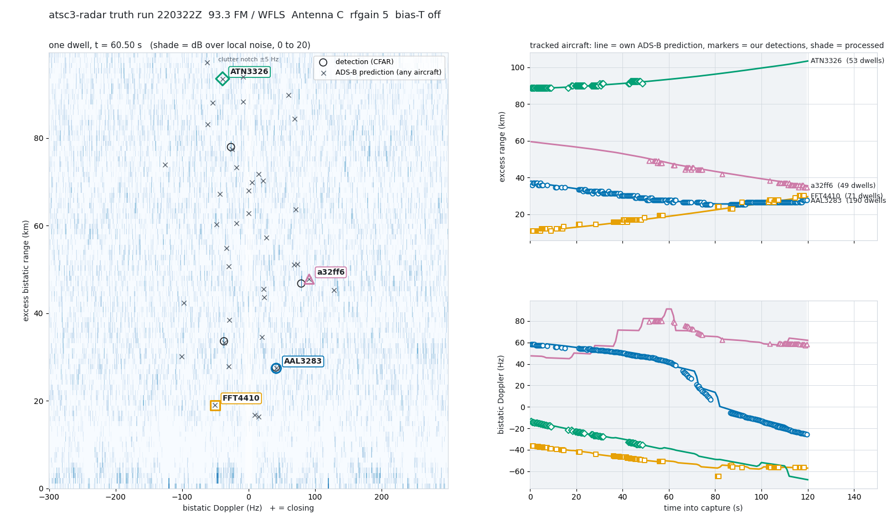

# The FM gain pair — 2026-10-24 22:03Z

The control owed by `FM_VS_ATSC3_1024.md`: WFLS-FM 93.3 on the discone,
two 120 s captures back to back at rfgain 5 and rfgain 6 (8 dB apart at
the ADC), truth polled ±5 min with the widened box.

| capture | UTC | rfgain | headroom | overflows | cancellation (median) |
|---|---|---|---|---|---|
| **A** | 22:03:22 | 5 | −10.4 dBFS | 0 | 29.6 dB |
| **B** | 22:05:25 | 6 | −18.5 dBFS | 0 | 29.4 dB |

85 truth polls, 11464 state vectors, 0 errors. A busier sky than the
21:23Z run: 56 aircraft predicted in the 120 km map.

## Each capture on its own

```
                              A (rfgain 5)      B (rfgain 6)
detections                        724               665
matched (2.2 km / 8 Hz)           445  (61 %)       523  (79 %)
distinct aircraft                  17                12
predicted-but-missed            39 / 56           44 / 56
worst shift null (far)            150               259
per-aircraft scramble p           0.00              0.00
8/21 far-range verdict        NOT confirmed     NOT confirmed
unmatched candidates                0                 0
```

The strict rule fails at both gains for a reason the ATSC 3.0 gain pair
already named and FM makes worse: with 1.2 km cells, a 2.2 km gate and
±5 min of truth, an aircraft whose bistatic range changes slowly stays
inside its own gate for a minute, and the next arrival on the same
approach is two minutes behind it. Clock-shift nulls of 150–259 against
real counts of 445–523 are what that sky looks like; the scramble null,
which cannot be gamed by a conveyor, is at p = 0.00 both times.

## Tracks across the gain change

The evidence that matters is continuity: the same aircraft, before and
after the gain step, each capture placing it where its own telemetry
says.

| aircraft | A (rfgain 5) | B (rfgain 6) |
|---|---|---|
| **AAL3283** | 190 dwells, 37.2 → 27.6 km, walk −81 / −87 m/s, 1.7 Hz | 98 dwells, 27.6 → 45.6 km, +184 / +168 m/s, 1.7 Hz |
| **a32ff6** (no callsign) | 49 dwells, 49.2 → 34.8 km, −212 / −216 m/s, 3.0 Hz | 153 dwells, 34.8 → 44.4 km, +81 / +74 m/s, 2.9 Hz |
| FFT4410 | 71 dwells, 10.8 → 30.0 km, +163 / +159 m/s, 0.9 Hz | 17 dwells, 33.6 → 45.6 km, +180 / +184 m/s |
| SWA2873 | 1 dwell at 73 km | 97 dwells, 73.2 → 80.3 km, +66 / +59 m/s, 1.1 Hz |
| UAL2463 | 14 dwells, 52.8 → 50.4 km | 73 dwells, 46.8 → 24.0 km, −213 / −207 m/s, 1.3 Hz |

AAL3283 was detected on **every one of 239 dwells** of capture A — the
whole two minutes — closed to 27.6 km, and capture B picked it up at
27.6 km opening, exactly where ADS-B puts it after the gain step. Nothing
about the detection changed with the gain except the headroom.

## The fixed-cell test, and what "fixed" means on FM

`gain_pair.py` found **10 cells** present in both captures at the same
(R_b, f_d), where ATSC 3.0 had found none. Asking which ADS-B aircraft
sat in each cell at those dwells (`lab/` probe):

```
cell                      A                     B
29.98 km  +49 Hz          AAL3283 23/23         a32ff6 17/17
32.38 km  +53 Hz          AAL3283 30/30         a32ff6 23/23
27.58 km  +39 Hz          AAL3283  6/6          a32ff6  2/3
23.98 km  +46 Hz          none    (4 dwells)    UAL2463 4/4
28.78 km -107 Hz          none    (6)           none (2)
28.78 km  +68 Hz          none    (4)           none (3)
27.58 km -103 Hz          none    (3)           none (1)
 3.60 km  +23 Hz          none   (10)           none (5)
 3.60 km  -21 Hz          none    (3)           JIA5257 1/9
```

The three strong "fixed" cells are **two different aircraft on the same
approach two minutes apart**: AAL3283 in A, a32ff6 in B, each matched on
every dwell. On ATSC 3.0, 43 m cells never coincide this way; on FM, a
1.2 km cell at the same point of the same approach does. The fixed-cell
test therefore needs the ADS-B check built in before it can veto, which
it now has in the record if not yet in the tool.

What remains is honest residue: four weak cells (3–6 dwells, 13–15 dB
over a 11.5–12.5 dB floor) at 27.6–28.8 km with no aircraft in either
capture, and the pair at 3.6 km with symmetric ±22 Hz Doppler, which at
a 3.2 m wavelength is ±35 m/s of sum-path rate at the same range: road
traffic in both directions, as expected inside 5 km. The four far cells
are reported, unexplained, and excluded from any claim; they are the
first thing to look at on a quieter sky.

## What can honestly be said

1. **No front-end product survived the gain change**: every strong cell
   common to both captures is a matched aircraft, and the only
   unexplained common cells are near-threshold and few.
2. Five aircraft tracked across the gain step, one on all 239 dwells of
   a capture, each placed by both captures where its telemetry says.
3. The strict 8/21 rule reads NOT confirmed at both gains, for the
   conveyor reason, now at FM's larger cell size. The labels stand.
4. **FM's gain-pair protocol needs its own fixed-cell rule**: a common
   cell counts as an artifact only if no ADS-B aircraft explains it in
   *either* capture. Pre-registered for the next FM run.

 — capture A at t = 60.5 s;
AAL3283 closing through 30 km, FFT4410 and ATN3326 opening, a32ff6 at
40 km.
