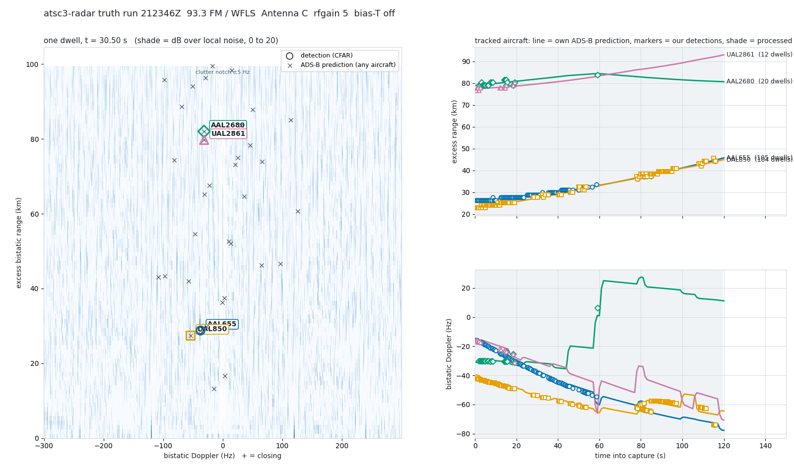

# FM versus ATSC 3.0, same receiver, same sky — 2026-10-24 21:23Z

Felbs: "Maybe we could try bouncing radar off FM since that's tried and
true with hams and see how it stacks up to ATSC 3." Two captures four
minutes apart under one ADS-B truth poll: an FM broadcast station on the
roof discone, then WNUV on the yagi. Same CAF, same cancellation, same
CFAR, same truth comparison, same nulls.

## The illuminator, chosen from the air

`tools/fm_survey.py` ranked the band from three 8 MHz captures on the
discone (Antenna C is the RSPdx Hi-Z port, rated to 200 MHz: in band for
FM, which is why it was deaf for ATSC 3.0 in August). The two strongest
carriers were identified by decoding their own RDS with
gr-radiotuna's `rds.py`: 93.3 announced itself as **WFLS-FM** (50 kW,
country, RadioText running) and 104.1 as WLNO (20 kW, foreign-language
program type). WFLS was chosen for power and dense programming; its FCC
coordinates are in `tools/stations/wfls_93.3.json`.

## What FM needs that ATSC 3.0 did not

- **A reconstructed reference.** One receiver, no decoding: the capture
  is FM-discriminated, the multiplex low-passed, and re-modulated at
  unit amplitude. A raw self-reference is useless with one channel: the
  ECA projects the surveillance onto itself and "cancels" 173 dB,
  targets included. The reconstruction has to be zero-phase (`filtfilt`);
  a 64-sample group delay from `lfilter` gave 0.003 correlation and no
  cancellation at all.
- **HD Radio is in the way.** WFLS carries IBOC digital sidebands at
  ±130–200 kHz, 14 dB below the analog carrier. They are not FM, the
  reconstruction cannot model them, and through resample_poly's default
  filter they capped cancellation at 23 dB. A 385-tap FIR cut at 105 kHz
  gives 29.6 dB on the same dwell; narrower bands lose it again because
  the constant-envelope model of the analog signal breaks as it is
  band-limited harder. Median cancellation over the run: **30.8 dB**.
- **A 1 s dwell** (170 ms for ATSC 3.0): a target walks 200 m in a
  1.2 km cell, so the integration can be six times longer, and Doppler
  resolves to 0.6 Hz at a 3.2 m wavelength.
- Gates: 2.2 km in range (1.5 cells plus clock slop), 8 Hz in Doppler.

## Result, side by side

```
                                FM 93.3 (discone)      ATSC 3.0 RF25 (yagi)
capture                         21:23:46Z, 120 s        21:27:49Z, 120 s
processed                       239 dwells x 1 s        3 windows x 13 s (162 dwells x 170 ms)
range cell                      1.2 km                  43 m
Doppler cell                    0.6 Hz                  ~6 Hz
cancellation (median)           30.8 dB                 (pilot-flattened, see FIRST_LOOK)
detections                      316                     248 / 240 / 72
matched to ADS-B                267  (84 %)             198 / 197 / 34  (80 / 82 / 47 %)
distinct aircraft matched       11                      8 across >= 2 windows
aircraft in map / missed        46 / 35  (76 %)         53-57 / 42-52  (79-91 %)
farthest matched aircraft       97 km (4 dwells), 79-84 km (18), 77-79 km (11)   ~30 km
mean |dR| on tracked aircraft   356-571 m               17-63 m
mean |df| on tracked aircraft   0.7-3.5 Hz              3.0-8.5 Hz
longest single track            AAL655: 100 dwells, 116 s, 26 -> 44 km, walk 156 vs 160 m/s
                                                        EDV5107: 111 dwells over 2 windows
8/21 far-range verdict          DETECTION-GRADE         NOT confirmed x 3 (route-following nulls, GAIN_PAIR_1024)
  real vs worst shift null      267 vs 59               38/60/27 vs 33/32/13
  per-aircraft scramble p       0.00                    0.00 / 0.00 / 0.00
unmatched candidates            0                       (not run; the 17:51-19:24 pass found 1 of 32)
```

FM tracked aircraft against their own telemetry:

| aircraft | dwells | detected range | predicted | mean \|ΔR\| | mean \|Δf\| | walk det / pred |
|---|---|---|---|---|---|---|
| AAL655 | 100 | 26.4 → 44.4 km | 26.3 → 44.8 km | 356 m | 1.2 Hz | +156 / +160 m/s |
| DAL850 | 92 | 22.8 → 44.4 km | 22.9 → 43.1 km | 443 m | 1.2 Hz | +195 / +183 m/s |
| AAL2680 | 18 | 79.2 → 83.9 km | 79.2 → 84.4 km | 521 m | 0.9 Hz | +84 / +91 m/s |
| UCA4978 | 20 | 33.6 → 34.8 km | 34.1 → 34.5 km | 467 m | 0.7 Hz | — |
| UAL2861 | 11 | 76.8 → 79.2 km | 77.5 → 78.6 km | 472 m | 1.8 Hz | — |
| CLUB22 | 4 | 97.1 km | 96.7 km | 441 m | 1.6 Hz | — |

ATSC 3.0, four minutes later: JIA5236 and JIA5248 tracked across all
three windows; EDV5107, AMX038, AAL582, MXY1696 across two; mean range
errors 17–63 m. JIA5236 was seen by **both** illuminators — at 55 km
excess range on FM and at 7.2 km on ATSC 3.0, which is the same aircraft
in two different bistatic geometries.

 — the FM run at t = 30.5 s with
every in-map prediction, and four aircraft across the capture.

## What the comparison says

1. **FM sees farther and reads Doppler better; ATSC 3.0 sees where.**
   FM matched aircraft at 77, 79 and 97 km with ~1 Hz Doppler error; its
   range error is a third of a cell. ATSC 3.0 places an aircraft within
   tens of metres but, with the yagi's beam and the 60 km map, its
   matches tonight stop near 30 km.
2. **FM passed the strict rule that ATSC 3.0 keeps failing**, and for a
   physical reason: with 1.2 km cells and an 8 Hz gate, two aircraft a
   minute apart on one approach do not share a cell, so the clock-shift
   nulls regain their power (worst 59 against 267). On ATSC 3.0 the same
   conveyor puts the next arrival in the same 490 m cell.
3. **The miss rate is similar** (76 % vs 79–91 % of aircraft predicted in
   the map), and most of the missed are small, far or near the baseline.
   Both illuminators see the same kind of target: airliners broadside.
4. The discone, which was voided in August as "deaf", is the better
   antenna for this band and was never wrong; the port was.
5. FM has no decoding step, no pilot comb, no bootstrap, and ran in
   122 s of CPU for 120 s of air. It is the cheaper radar by far. What
   it cannot do is the 43 m range cell, and that is the one thing a
   single-receiver non-ADS-B claim will eventually need to separate a
   target from the traffic around it.

## Owed

- A gain pair on FM, as on ATSC 3.0, before "artifact-free" is said.
- The unmatched pass on FM with the far end of its ellipse in the truth
  box (the widened box applied to this run already).
- A second FM station, ideally one without HD Radio, to see whether the
  cancellation floor moves.
