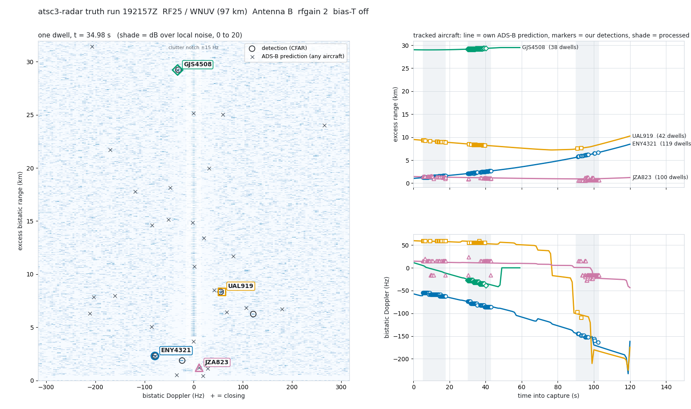

# The gain pair — 2026-10-24 19:21Z

The control owed by `TRUTH_RUN_1024.md`: two captures back to back at two
RF gains, same antenna, so that anything the front end makes (intermod of
the direct signal, a pilot-comb leftover, a spur) can be told from
anything the sky makes. Truth polled for five minutes either side so the
±180 s and ±300 s nulls have coverage this time.

## What was recorded

First attempt, 19:01Z: the rfgain 2 capture **stalled for 6.7 s**
mid-stream (120.0 s of samples in 126.7 s wall, one overflow) and the
capture tool voided it. Its rfgain 3 partner (19:09:06Z) was clean and is
kept below as capture C. The pair was re-run with nothing else of ours
on the machine.

| capture | UTC | rfgain | headroom | overflows | bootstrap peak ratio | verdict |
|---|---|---|---|---|---|---|
| — | 19:06:53 | 2 | −13.0 dBFS | 1 (6.7 s gap) | 85.6 | **VOID** |
| **C** | 19:09:06 | 3 | −14.2 dBFS | 0 | 79.6 | usable |
| **A** | 19:21:57 | 2 | −17.7 dBFS | 0 | 81.9 | usable |
| **B** | 19:24:02 | 3 | −20.7 dBFS | 0 | 98.5 | usable |

Antenna B (Old Faithful), bias-T off, IFGR 32, 120.0 s each, integrity
exact. Truth: 85 polls / 7846 state vectors / 0 errors over 14 minutes
for the A–B pair; 86 / 7857 / 0 for the first attempt. Pilot lock held on
every dwell of every window (0 VOID dwells of 486).

## Test 1 — fixed cells across a gain change

`tools/gain_pair.py`: cells detected in both captures at the same
(R_b, f_d), persisting ≥ 3 dwells in each, within one range bin and 6 Hz.
A front-end product sits still; an aircraft moves hundreds of metres in
the 2 minutes between A and B.

```
window     A persistent cells   B persistent cells   common
t=5-18 s          (listed)            (listed)          0
t=30-43 s                                               0
t=90-103 s                                              0
C vs A, t=30-43 s (12 min apart, different gains)       0
```

**Nothing persistent survived the gain change at a fixed cell.** The
intermodulation hypothesis from `TRUTH_RUN_1024.md` is rejected for
these captures.

## Test 2 — the same aircraft, in both captures, where its ADS-B says

| aircraft | capture A (rfgain 2) | capture B (rfgain 3, +2 min) |
|---|---|---|
| ENY4321 | 119 dwells, 1.2 → 6.7 km over 3 windows | 3 dwells at 8.5–11.2 km (predicted 8.6–11.2) |
| JZA823 | 97 dwells, 0.6–1.5 km | 21 dwells, 1.1–4.9 km (predicted 1.5–4.9) |
| JIA5599 | 13 dwells, 3 windows | 7 dwells, 2 windows |

Three aircraft detected at both gains, each capture placing them where
their own telemetry put them at that minute. That, plus Test 1, is what
"not a front-end artifact" looks like.

## Test 3 — the ADS-B verdict, each capture on its own

R_b ≥ 5 km field, nulls on the same cells, the 8/21 rule as written:

```
                      real  aircraft  worst shift null  scramble p   8/21 verdict
A  t=5-18 s             19     3            13             0.00     NOT confirmed
A  t=30-43 s            80     7            29             0.00     NOT confirmed
A  t=90-103 s           26     4             9             0.00     NOT confirmed
B  t=5-18 s              2     2            36             0.06     NOT confirmed
B  t=30-43 s            28     3             2             0.00     DETECTION-GRADE
B  t=90-103 s            2     1             1             0.06     NOT confirmed
C  t=5-18 s             85    >=2            6             0.00     DETECTION-GRADE
C  t=30-43 s             8     1             8             0.20     NOT confirmed
C  t=90-103 s           27    >=2           12             0.00     NOT confirmed
```

Two of nine windows pass the rule. Capture A, with the strongest tracks
of the day, fails all three. Here is why, and it is a finding about the
rule, found by asking which aircraft make up each null
(`lab/null_composition` probe, capture A):

```
A t=30-43 s, 120 far detections
  real          80 matches on 7 aircraft  [GJS4508 38, UAL919 28, MYSTC40 10, ...]
  shift -180 s  28 matches on 2 aircraft  [EIN11T 27, AAL524 1]     at 8.2 km, ~55 Hz
  shift  +60 s  29 matches on 2 aircraft  [RPA4470 28, EJA975 1]    at 8.2 km, ~55 Hz
  shift  -60 s   0
A t=5-18 s
  shift -180 s  13 matches on 2 aircraft  [EIN11T 12, N13796 1]     at 8.8-11.6 km, ~59 Hz
```

Every large shift null is **one aircraft**, and it lands on the cell
where UAL919 really was. EIN11T three minutes earlier and RPA4470 one
minute later were on the same approach path as UAL919, so shifting the
clock by the spacing between consecutive arrivals puts a *different*
aircraft's track through the *same* bistatic cell. The null is not
measuring chance; it is measuring the conveyor belt of approach traffic
on one route. In that regime "real > 3 × every shift null" cannot be
met by exactly the detections that are most real, and the stronger the
approach stream, the worse it gets. The 17:51Z run passed the same rule
in part because its ±180/±300 s nulls had no truth coverage and could not
score — stated in that doc, and now quantified.

The **per-aircraft clock scramble** does not have this problem (each
aircraft gets its own random offset, so no single route-follower can
reproduce a cell on cue): median 1–3 against real counts of 19–85, p =
0.00 in every window where real ≥ 19.

## Test 4 — trajectories

`lab/trajectory_EA.txt`, `_EB`, `_EC`. Aircraft tracked across all three
windows (≥ 60 s span), detection walk rate vs its telemetry:

| capture | aircraft | dwells | windows | det → pred range | walk det / pred (m/s) | mean \|ΔR\|, \|Δf\| |
|---|---|---|---|---|---|---|
| A | **ENY4321** | 119 | 3 | 1.21→1.65, 2.13→2.69, 5.77→6.72 km | 33.7/33.0, 43.9/44.2, 85.5/86.5 | 21–85 m, 1.2–2.9 Hz |
| A | **UAL919** | 42 | 3 | 9.28→8.85, 8.46→8.20, 7.55→7.63 km | −34/−32, −30/−31 | 42–48 m, 0.7–2.2 Hz |
| A | GJS4508 | 38 | 1 | 29.15→29.32 km (pred 29.15→29.32) | — | **0 m**, ~0 Hz, 19.8 dB |
| A | JZA823 | 97 | 3 | 0.6–1.5 km | −17/−8, −8/−6, +8/+4 | 62–284 m |
| B | AAL2268 | 43 | 3 | 4.12→3.69, 3.34→3.17, 3.04→3.08 km | −36/−37, −17/−22 | 95–442 m |
| C | UAL2668 | 101 | 3 | | | |
| C | RPA4576 | 67 | 3 | | | |
| C | UAL109 | 16 | 3 | | | |

ENY4321 is the best track the instrument has produced: 119 dwells over
97 s, three walk rates matched to 1–2 %, Doppler within 3 Hz throughout,
up to 26 dB over local noise. GJS4508 at 29 km is the farthest clean
track, with zero mean range error.

 — capture A at t = 35 s with every
in-map prediction, and the four aircraft across the capture.

## What can honestly be said

1. **Front-end artifacts are ruled out** for these captures: no cell
   survived a gain change, and three aircraft were seen at both gains
   where ADS-B put them.
2. By the 8/21 rule as written, the far-range verdict is DETECTION-GRADE
   in 2 of 9 windows and NOT confirmed in 7, **and the rule is now shown
   to fail for a known, measured reason** (one route-following aircraft
   per null) rather than for lack of signal. The labels stand as the
   rule's output. They are not upgraded here.
3. On the controls that cannot be gamed by a conveyor belt — the
   per-aircraft scramble, the fixed-cell test, and the trajectory test —
   today's three captures contain at least seven aircraft tracked across
   all three windows with walk rates matching their own telemetry.
4. Capture-to-capture detection counts vary a lot (2 to 85 far matches)
   with the same hardware minutes apart. That is the sky, not the radio:
   which aircraft are inside 20 km and off the baseline at that minute.

## Rule change, pre-registered for the next run (not applied to today)

Written after seeing the above, so it binds the future only:

- Shift nulls are still computed and reported **with their per-aircraft
  composition**. The 3× veto moves from "every shift null" to **the
  median of the six shift nulls**, and any single null that is ≥ 80 % one
  aircraft is flagged as route-following and noted, not used as a veto.
- The per-aircraft clock scramble (p < 0.01) stays as the binding null.
- The fixed-cell gain-pair test (0 common cells outside the notch) is
  binding whenever two gains were captured.
- Trajectory: ≥ 2 aircraft tracked across ≥ 2 windows ≥ 60 s apart with
  walk rate within 25 % of telemetry and mean |Δf| < 10 Hz.
- Verdict DETECTION-GRADE only if all of the above hold.

Then the goal that counts: a persistent far-range track that matches no
ADS-B aircraft, reported with the same controls.
