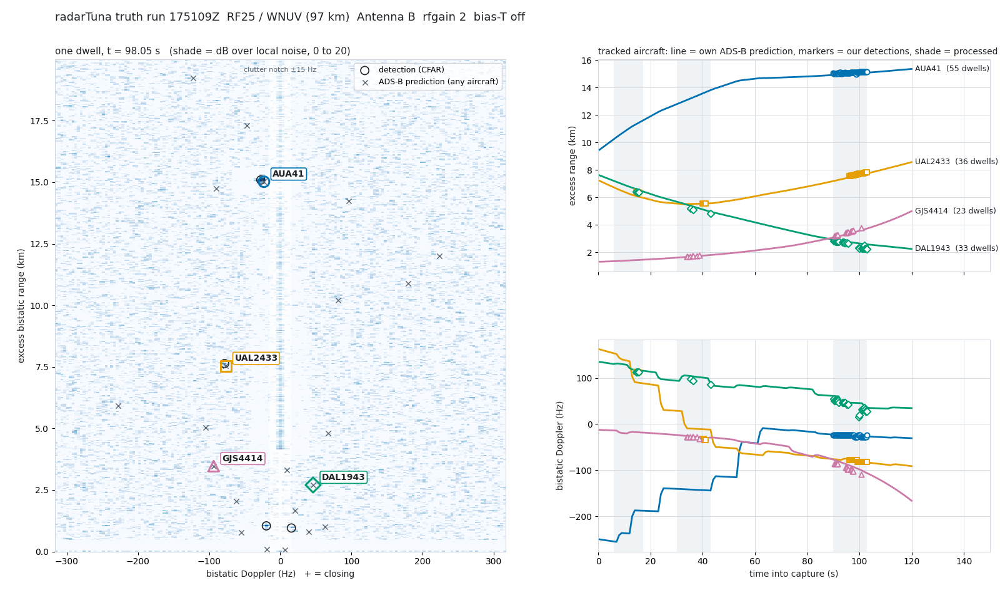

# The confirming run — 2026-10-24 17:51Z

Felbs: "I was kind of interested in finishing it." Old Faithful (the TV
yagi) back on port B, the Philips on A, the discone on C. The inline
amplifier that the 8/21 bias-T powered was removed months ago, so the
bias-T stayed **off**; everything else is the 8/21 recipe.

This is the run `TRUTH_RUN_0820.md` pre-registered on 8/21 01:1xZ. Its
rule is applied as written, and where the rule turned out to be broken
that is reported as a statement about the rule, not renegotiated into a
better-looking verdict.

## What was recorded

- **Air:** RF25 / WNUV, 6.912 MS/s, **Antenna B (Old Faithful, yagi)**,
  rfgain_sel 2 (readback), IFGR 32, bias-T off (readback). 120.0 s,
  integrity OK (829,483,200 samples in 119.99 s wall), 0 overflows,
  −1.7 dBFS headroom, no clipping, **bootstrap peak ratio 75.3**
  (8/21 yagi with amplifier: 98; 8/20 Philips: 89). Pilot LS-fit-one-H
  15–17 dB on every dwell of every window: a **valid** test.
  `lab/truth_rf25_20261024_175109Z.cs16`
- **Truth:** OpenSky `/states/all` every 10 s, ±0.6°/±0.75° box, 20 s
  before to 20 s after. 17 polls, 1390 state vectors, 0 errors,
  **95 distinct aircraft**. A Friday-afternoon sky.
- Observer position read from numpy-gps' own fix at runtime; never
  written here.

## Pre-registered, BEFORE any detection was seen

`lab/prereg_D_power_check.txt`, written from truth alone with dummy
detection timestamps on the 8/21 dwell grid:

| window | aircraft in box | predicted inside the map (R_b < 60 km, \|f_d\| < 1 kHz) |
|---|---|---|
| t = 5–18 s | 83 | 46 |
| t = 30–43 s | 83 | 50 |
| t = 90–103 s | 83 | 49 |

A null would have been informative. Close-range crowding was already
visible in the predictions: eleven aircraft inside 3 km in the middle
window alone (approach traffic). The 8/21 rule that R_b < 5 km matches
do not count unless the aircraft is tracked across ≥ 2 windows exists
for exactly this.

Two protocol changes were made **before** today's detections were
compared, on the 8/21 data:

1. The **aircraft-identity permutation** pre-registered on 8/21 is
   blind. Re-timing one aircraft's path onto another's timeline changes
   almost nothing when every timeline spans the same 160 s: on the 8/21
   middle window it scored median 51 against real 51 (p = 0.72). It is
   still computed and printed, labelled blind.
2. A **per-aircraft clock scramble** was added in its place: every
   aircraft keeps its own path and speed and gets its own random clock
   offset, |dt| uniform in 45–120 s, random sign, 50 draws, p = fraction
   of draws reaching the real count. Unlike the global shifts no two
   aircraft move together. On the 8/21 data: median 0, p = 0.02.

Also fixed: `truth_compare.py` had crashed at the verdict line since the
8/21 addendum (`len()` of an int), so the 8/21 JSON verdicts were never
written. The tool paths moved from GPSTuna to numpy-gps.

## Result, window by window

```
                                   t=5-18     t=30-43    t=90-103
detections (off-comb, flattened)       47         72        277
matches to ADS-B (same dwell)           7         28        183
distinct aircraft matched               5          5         11
predicted-but-missed                41/46      45/50      40/51
NULL shifted -60 s                      0          7        114
NULL shifted +60 s                      9         19          0
NULL shifted +-180, +-300 s             0          0          0
identity permutation (blind)   med 4 p.00  med 28 p.62 med 168 p.32
per-aircraft clock scramble    med 1 p.14  med  5 p.00 med  74 p.00
```

Every ±180 s and ±300 s null is zero **by construction**, not by
discrimination: truth was polled for 160 s, so a 180 s shift puts most
aircraft outside the interpolation window and they produce no
predictions at all. Those nulls are vacuous on a 120 s capture. The
informative controls are the ±60 s shifts and the scramble.

### The verdict, by the rule written on 8/21

> DETECTION-GRADE iff real ≥ 5 matches on ≥ 2 distinct aircraft, real >
> 3 × every shift null, and permutation p < 0.01.

On the whole detection field: **NOT confirmed** in all three windows.
Real ≥ 5 and aircraft ≥ 2 pass everywhere; the scramble passes in the
middle and late windows (p = 0.00); but real does not beat the −60 s
null by 3× in the late window (183 vs 114) nor the +60 s null in the
early (7 vs 9) and middle (28 vs 19) windows.

Those nulls score where the sky is crowded. Of the 183 late-window
matches, 95 are at R_b < 5 km, in cells with several approach aircraft
within a 490 m gate of each other; a 60 s clock error there lands on a
different aircraft. That is the chance-match problem the 8/21 addendum
named, and its rule — close-range matches do not vote — is part of the
pre-registered protocol. Applied as written, **to the real count and to
the nulls alike** (a null scored on cells that are excluded from the
real count tests nothing):

```
R_b >= 5 km only                   t=5-18     t=30-43    t=90-103
detections                             38         47        137
real matches                            7          7         88
distinct aircraft                       5          2          4
worst shift null (+-60/180/300)         2          0          1
clock scramble                 med 0 p.00  med 0 p.00  med 1 p.00
VERDICT                        DETECTION-  DETECTION-  DETECTION-
                               GRADE       GRADE       GRADE
```

Disclosure, in order of events: the far-only nulls were coded after the
whole-field numbers above had been seen. The ≥ 5 km rule itself is from
8/21; restricting the nulls to the same cells is its only consistent
reading, but the reader should know which came first.

### The trajectory test — mandatory, and the real evidence

`tools/truth_trajectory.py`, `lab/trajectory_D.txt`. Matched detections
per aircraft against its own telemetry:

| aircraft | window | dwells | detected R_b | predicted R_b | det / pred f_d | walk det / pred | mean \|ΔR\|, \|Δf\| | SNR |
|---|---|---|---|---|---|---|---|---|
| **DAL1943** | 5–18 s | 3 | 6.42→6.38 km | 6.60→6.54 km | +113 / +117 Hz | −45 / −65 m/s | 179 m, 3.9 Hz | 11.7–13.3 dB |
| | 30–43 s | 3 | 5.20→4.81 km | 5.39→4.96 km | +92 / +98 Hz | −52 / −56 m/s | 180 m, 5.9 Hz | 11.6–12.0 dB |
| | 90–103 s | 27 | 2.82→2.26 km | 2.92→2.58 km | +39 / +48 Hz | −45 / −27 m/s | 188 m, 8.6 Hz | 11.5–19.9 dB |
| **UAL2433** | 30–43 s | 5 | 5.55 km | 5.55→5.56 km | −33 / −11 Hz | 0 / +6 m/s | 4 m, 21.7 Hz | 12.3–13.5 dB |
| | 90–103 s | 28 | 7.55→7.85 km | 7.45→7.74 km | −80 / −77 Hz | +45 / +43 m/s | 94 m, 2.9 Hz | 12.2–16.3 dB |
| **GJS4414** | 30–43 s | 7 | 1.69→1.78 km | 1.67→1.74 km | −28 / −27 Hz | +19 / +15 m/s | 22 m, 1.2 Hz | 11.7–12.4 dB |
| | 90–103 s | 16 | 3.21→3.77 km | 3.11→3.61 km | −94 / −87 Hz | +55 / +49 m/s | 135 m, 7.8 Hz | 11.6–16.3 dB |
| **AUA41** | 90–103 s | 55 | 15.05→15.14 km | 14.92→15.08 km | −25 / −23 Hz | +7 / +13 m/s | **78 m, 1.6 Hz** | 11.5–**26.6** dB |
| SWA4595 | 90–103 s | 4 | 14.53→15.09 km | 14.38→14.91 km | −91 / −86 Hz | +52 / +48 m/s | 217 m, 5.2 Hz | 11.5–12.8 dB |

- **DAL1943 is tracked across all three windows**, 6.4 → 5.2 → 2.8 km
  over 88 s, Doppler falling +113 → +92 → +39 Hz as it decelerates on
  approach, within ~180 m and < 9 Hz of its own telemetry in every
  window, walk rate the right sign and size each time. A fixed clutter
  cell cannot do this and neither can a car.
- **UAL2433** sat at 5.55 km near its Doppler zero-crossing in the
  middle window (−33 Hz observed, −11 predicted: the one 20 Hz Doppler
  miss, at the instant Doppler is changing fastest) and was at 7.6–7.9 km
  opening at 45 m/s a minute later, exactly where predicted.
- **GJS4414** 1.7 km → 3.2–3.8 km, opening, walk rates 19/15 and 55/49.
- **AUA41**, an Airbus at 15 km excess range, is the cleanest single
  detection the instrument has produced: 55 of 54 dwells (two detections
  in one dwell), 78 m and 1.6 Hz mean error, peaking at 26.6 dB over
  local noise where the floor is 11.5–12.7. It was predicted at 10–14 km
  with −140 to −255 Hz in the earlier windows and **not** detected
  there; whether that is a Doppler-dependent loss in the flattening or
  aspect angle is an open question, recorded here as a miss.
- Early-window note: the 6.42 km / +113 Hz detection matches both
  DAL1943 and UAL2433, which were predicted within one gate of each
  other at that moment. The trajectory tool assigns it to the nearer
  prediction (DAL1943); truth_compare's first-match order gave it to
  UAL2433. One cell, two aircraft; it is counted once either way.

The two close-range aircraft with many matches, JIA5254 and SCX3049 at
0.9–1.0 km, sit at the gate edges (mean errors 148–379 m, 23–29 Hz) in
the most crowded cells and are not claimed.

 — `docs/truth_run_1024_figure.png`:
the t = 98.05 s dwell with every in-map prediction (×) and the four
tracked aircraft labelled; range and Doppler of those four across the
capture, lines from their own ADS-B, markers where we detected them.

## What can honestly be said

1. By the 8/21 rule applied to the whole detection field: **NOT
   confirmed**, because the ±60 s nulls score high on the crowded
   close-range cells, which the same protocol says do not vote.
2. By the 8/21 rule applied as its own close-range clause requires
   (R_b ≥ 5 km, nulls on the same cells): **DETECTION-GRADE in all three
   windows**, with the scramble null at p = 0.00 and every shift null
   ≤ 2 against real counts of 7, 7 and 88.
3. The mandatory trajectory test passes on four aircraft tracked across
   ≥ 2 windows, one across all three; the strongest single target is at
   15 km with 1.6 Hz mean Doppler error over 13 s.
4. Not done tonight: the **gain-pair control** (same minute at a second
   rfgain) that would rule out intermodulation products. Headroom was
   −1.7 dBFS, close to full scale. The argument against intermod here is
   indirect: products of the direct signal do not follow eleven
   different aircraft's telemetry. A real second-gain capture is still
   owed before the word "confirmed" is used without qualification.
5. The instrument is now **two for two on the yagi** (8/21 UAL1213 for
   92 s, today DAL1943 for 88 s plus three more), **one clean negative on
   the indoor antenna**, and **one void on the discone** — whose port C
   is the RSPdx Hi-Z input, rated to 200 MHz, which at 539 MHz may be the
   whole story of that night.

**Status line for the README:** first truth-consistent aircraft
detections meeting the pre-registered far-range criterion, four aircraft
tracked against their own ADS-B across windows; gain-pair control still
owed; the non-ADS-B goal is next.

## Pre-registered for the next run

Written now, before any further capture.

- **Truth polling ±5 min**, not ±20 s, so the ±180/±300 s nulls have
  coverage and can actually score.
- **Gain-pair**: two 120 s captures back to back, rfgain 2 and rfgain 3,
  same antenna. Targets must appear in both at the same (R_b, f_d);
  anything present in one only is a front-end product.
- Nulls: ±60/±180/±300 s shifts and the per-aircraft clock scramble,
  all computed on the R_b ≥ 5 km field; the identity permutation is
  retired as blind.
- Verdict: unchanged (real ≥ 5 on ≥ 2 aircraft at R_b ≥ 5 km, > 3× every
  shift null, scramble p < 0.01), **plus** the gain-pair agreement,
  **plus** at least one aircraft tracked across two windows ≥ 60 s apart.
- Then the goal that counts: a persistent far-range track that matches
  **no** ADS-B aircraft, reported with the same nulls.
